Estudio Ingeniería de Sistemas en Tunja y por ahora escribo código desde Jaén, España.  
Hice un POS para un restaurante de verdad, un sistema de reservas y parte de un panel de monitoreo para un hospital. Todo está en mi portafolio.  
También investigo sobre IA y neurociencia, y fundé USERVICE. Busco prácticas o un puesto junior, presencial o en remoto.

  
  
  

Stack

  
  
  
  
  
  
  
  
  
  
  
  
  
  
  

