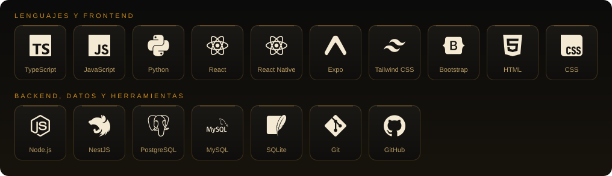

## Ingeniero de Sistemas en formación y desarrollador full-stack

Estudio en la **Universidad Santo Tomás (Tunja)** y este semestre curso en la **Universidad de Jaén (España)**, dentro de un programa de movilidad académica.

Desarrollo software a medida. Diseñé y entregué un sistema POS para un restaurante, construí un sistema de reservas full-stack y participé en un panel de monitoreo de infraestructura para el Hospital Universitario San Rafael de Tunja. Soy fundador de [USERVICE S.A.S.](https://www.userviceglobal.com/).

Investigo en inteligencia artificial y neurociencia computacional; mi ponencia fue reconocida como la mejor del congreso CIIESGEDO 2026. También desarrollo **Essentius**, un proyecto propio relacionado con esa investigación en neurociencia.

**Busco prácticas o un puesto junior en desarrollo de software, presencial o en remoto.**

  
  
  

### Tecnologías

### Essentius

Proyecto propio relacionado con mi investigación en neurociencia. El código está en dos repositorios: uno de frontend y otro de backend.
